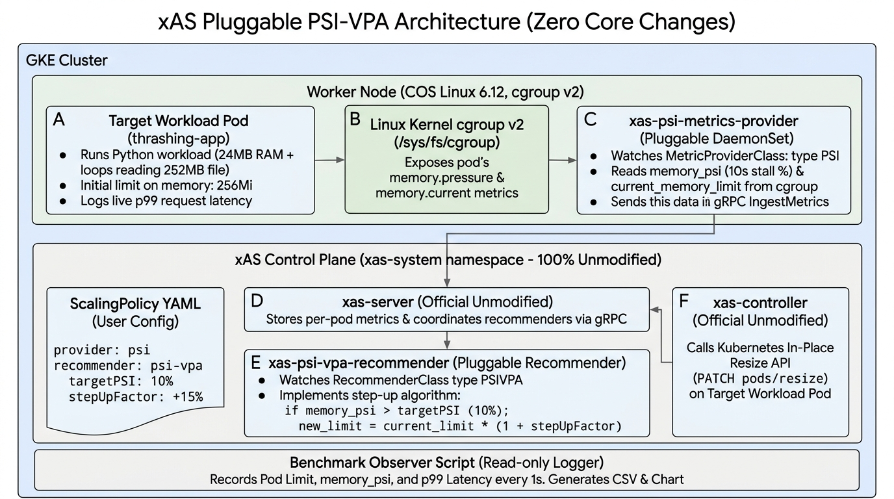
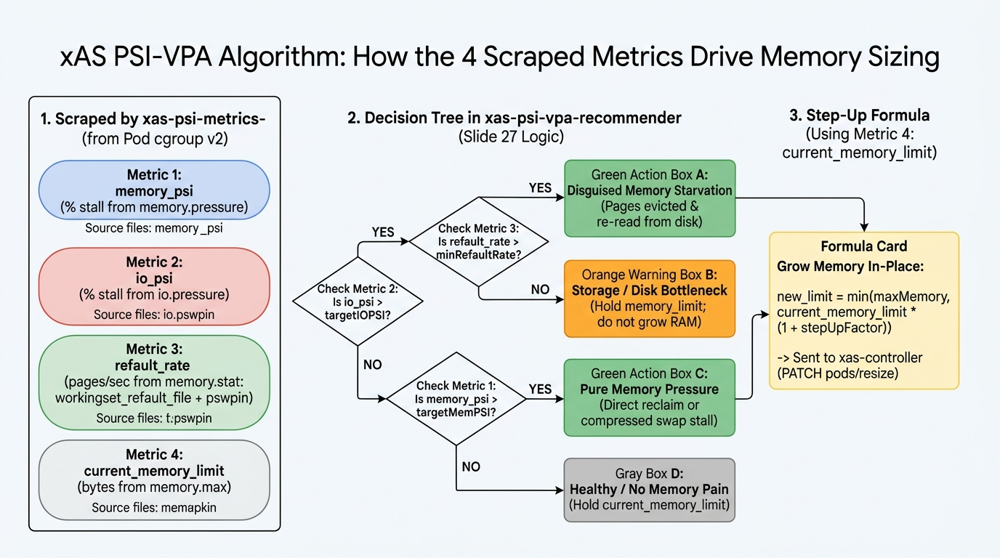

# PSI-Driven Vertical Pod Autoscaling (PSI-VPA) for xAS

[](LICENSE)
[](https://github.com/gke-labs/extensible-workload-autoscaler)

A standalone, pluggable **Linux Kernel Pressure Stall Information (PSI) Metric Provider** and **PSI-VPA Recommender** for the **[Extensible Workload Autoscaler (xAS)](https://github.com/gke-labs/extensible-workload-autoscaler)**.

---

## 1. Problem Statement: Why Standard VPA Fails on Thrashing Pods

Standard Kubernetes Vertical Pod Autoscaler (VPA) right-sizes containers based on `container_memory_working_set_bytes` (`memory.current - inactive_file`). On Linux cgroup v2 (`mm/vmscan.c`), when a container's hot file working set slightly exceeds its memory limit (`memory.max`):

1. The kernel enters synchronous direct reclaim and enforces a ~1:1 `active_file : inactive_file` ratio (`shrink_active_list()`), demoting ~40% of hot pages onto `inactive_file`.
2. Because Kubelet subtracts `inactive_file`, **reported `working_set_bytes` drops by ~40% right when the pod begins violently thrashing** (`p99` latency spikes 15–25×).
3. **Standard VPA is fooled by the drop in `working_set_bytes`** and recommends *shrinking* the starving pod instead of rescuing it.
4. Furthermore, at higher memory overshoots ($1.5\times$ limit), `memory.pressure` itself fades ("the quiet trap") while `io.pressure` and `workingset_refault_file` remain high—requiring a multi-signal decision tree rather than a single metric threshold.

---

## 2. System Architecture (Zero Core Changes to xAS)

This repository implements PSI-aware Vertical Pod Autoscaling as **100% pluggable xAS extensions** (`MetricProviderClass` and `RecommenderClass`), requiring **zero modifications** to `xas-server` or `xas-controller`.



### Components

| Component | Type | Role |
| :--- | :--- | :--- |
| **`xas-psi-metrics-provider`** | Pluggable DaemonSet (`MetricProviderClass: PSI`) | Runs on each node (mirroring xAS's `core-node-metrics-provider`), reads cgroup v2 files from `/sys/fs/cgroup` every 2s for pods matching active `ScalingPolicies`, computes windowed rates, and streams them to `xas-server` via gRPC `IngestMetrics`. |
| **`xas-psi-vpa-recommender`** | Pluggable Deployment (`RecommenderClass: PSIVPA`) | Polls `xas-server` via `GetControlMetrics`, evaluates the 4-metric Slide 27 decision tree per pod container, and pushes in-place memory resize recommendations back via `UpdateRecommenderState`. |
| **`xas-server` & `xas-controller`** | Official xAS Control Plane (Unmodified) | Aggregates per-container metrics and actuates in-place pod vertical scaling via the Kubernetes `pods/resize` subresource (`PATCH pods/<name>/resize`). |

---

## 3. Algorithm: How the 4 Scraped Metrics Drive Memory Sizing

To resolve both pure memory pressure and "disguised memory contention" (where memory starvation presents as I/O stalls), `xas-psi-metrics-provider` scrapes **4 metrics** from each pod's cgroup v2 hierarchy, and `xas-psi-vpa-recommender` evaluates the decision tree below:



### Scraped Signals & Decision Roles

| # | Metric Name | Cgroup v2 Source File | Calculation | Role in Recommender Algorithm |
| :-: | :--- | :--- | :--- | :--- |
| **1** | **`memory_psi`** | `memory.pressure` (`some total`) | `(Δtotal_us / Δt_us) × 100` | **Diamond 3:** Detects pure memory pressure (synchronous direct reclaim or compressed swap stalls when disk I/O PSI is low). |
| **2** | **`io_psi`** | `io.pressure` (`some total`) | `(Δtotal_us / Δt_us) × 100` | **Diamond 1:** Detects block I/O stalls, which may be caused either by evicted memory pages refaulting from disk or by a genuine storage bottleneck. |
| **3** | **`refault_rate`** | `memory.stat` (`workingset_refault_file + pswpin`) | `Δpages / Δt_sec` | **Diamond 2:** Disambiguates high `io_psi`. High `refault_rate` proves pages are being evicted and re-read (**Disguised Memory Starvation → Grow RAM**). Low `refault_rate` indicates a **Storage Bottleneck → Hold RAM**. |
| **4** | **`current_memory_limit`** | `memory.max` | Current limit in bytes | **Step-Up Formula:** Multiplied by `(1 + stepUpFactor)` (e.g. `+15%`) to compute the new in-place memory limit when memory starvation is detected. |

### Step-Up Formula

```text
if (io_psi > targetIOPSI && refault_rate > minRefaultRate) || (memory_psi > targetMemPSI):
    new_limit = min(maxMemory, ceil(current_memory_limit * (1 + stepUpFactor)))
else:
    new_limit = current_memory_limit
```

---

## 4. Repository Structure

```text
xas-psi-vpa/
├── psi-metrics-provider/
│   ├── main.go                           # DaemonSet entrypoint (mirrors cmd/core-node-metrics-provider/main.go)
│   └── scraper.go                        # Cgroup v2 PSI scraper (mirrors internal/core-node-metrics-provider/scraper.go & kubelet.go)
├── psi-vpa-recommender/
│   ├── main.go                           # Recommender entrypoint (mirrors cmd/core-recommenders/main.go & engine.go)
│   ├── psivpa.go                         # Slide 27 4-metric decision tree (mirrors internal/recommenders/vpa/vpa.go)
│   └── psivpa_test.go                    # Unit tests covering all 4 branches of Slide 27
├── deploy/
│   ├── xas-psi-metrics-provider.yaml           # RBAC, MetricProviderClass (PSI), and DaemonSet
│   ├── xas-psi-vpa-recommender.yaml            # RBAC, RecommenderClass (PSIVPA), and Deployment
│   ├── sample-thrashing-workload.yaml          # Scenario 2 marginal-fit thrashing workload (15s healthy warmup -> active load)
│   ├── sample-psi-vpa-scalingpolicy.yaml       # ScalingPolicy wiring the 4 PSI metrics to psi-vpa recommender
│   └── sample-standard-vpa-scalingpolicy.yaml  # ScalingPolicy using standard Kubelet working_set_bytes + xAS vpa recommender
├── docs/
│   ├── architecture.jpg                        # System architecture diagram
│   └── algorithm.jpg                           # 4-metric decision tree flowchart
├── demo.sh                                     # Interactive live demo & terminal monitor with automatic cleanup
├── go.mod
└── README.md
```

---

## 5. Build, Deploy & End-to-End Verification

### Prerequisites
- A Kubernetes cluster (v1.33+ with `InPlacePodVerticalScaling` enabled and Linux cgroup v2 nodes)
- Core [xAS](https://github.com/gke-labs/extensible-workload-autoscaler) control plane (`xas-server`, `xas-controller`, `xas-core-recommenders`, and `xas-core-node-metrics-provider`) running in the `xas-system` namespace
- Go 1.24+, `kubectl`, and `jq` installed locally

### Step 1: Verify Cluster Context & Core xAS Control Plane
Ensure `kubectl` points to your target cluster and that the core xAS pods are running:
```bash
kubectl config current-context
kubectl get pods -n xas-system
```

### Step 2: Build & Deploy `xas-psi-metrics-provider`
Set `KO_DOCKER_REPO` to your container registry (e.g., `gcr.io/<your-project>` or `ttl.sh/<your-user>`) and deploy the DaemonSet and `MetricProviderClass`:
```bash
export KO_DOCKER_REPO=<YOUR_CONTAINER_REGISTRY>

go run github.com/google/ko@latest apply -f deploy/xas-psi-metrics-provider.yaml
kubectl rollout status daemonset/xas-psi-metrics-provider -n xas-system
kubectl get metricproviderclass psi
```

### Step 3: Build & Deploy `xas-psi-vpa-recommender`
Build and deploy the `PSIVPA` recommender Deployment and `RecommenderClass`:
```bash
go run github.com/google/ko@latest apply -f deploy/xas-psi-vpa-recommender.yaml
kubectl rollout status deployment/xas-psi-vpa-recommender -n xas-system
kubectl get recommenderclass psi-vpa
```

### Step 4: Run the Live Thrashing Rescue Demo (PSI-VPA vs. Standard VPA)
You can use `./demo.sh` to compare how **PSI-VPA** and **Standard VPA** behave on the exact same marginal-fit thrashing workload (`Ctrl+C` automatically cleans up the workload and policy after each run):

#### 1. Run with PSI-VPA (Rescues the Thrashing Pod)
`./demo.sh` deploys `thrashing-app` (at `256Mi` with a 15-second healthy warm-up) and attaches `sample-psi-vpa-scalingpolicy.yaml`. When page-cache thrashing begins (`p99` spikes to `~20–30ms`), PSI-VPA detects the pressure and scales the pod in-place (`256Mi -> 295Mi -> 340Mi`) with `0` restarts, restoring `~0.8ms` `p99` latency:
```bash
./demo.sh
```

#### 2. Compare with Standard VPA (`--standard-vpa`)
Run `./demo.sh --standard-vpa` to attach `sample-standard-vpa-scalingpolicy.yaml` (which uses Kubelet's `container_memory_working_set_bytes` and xAS's built-in `vpa` recommender) to the same scenario. Because direct reclaim demotes hot pages to `inactive_file`, `working_set_bytes` drops during thrashing and Standard VPA fails to scale the pod up (leaving it thrashing):
```bash
./demo.sh --standard-vpa
```

#### 3. Manual `kubectl` Commands (Alternative to `./demo.sh`)
```bash
# Deploy the sample thrashing workload
kubectl apply -f deploy/sample-thrashing-workload.yaml
kubectl rollout status deployment/thrashing-app

# Apply either the PSI-VPA policy OR the Standard VPA policy
kubectl apply -f deploy/sample-psi-vpa-scalingpolicy.yaml
# kubectl apply -f deploy/sample-standard-vpa-scalingpolicy.yaml
```

### Step 5: Inspect Live Signals & In-Place Resize State with `kubectl`
```bash
# Watch workload phase and p99 read latency (~0.8ms warmup -> ~20-30ms thrashing -> ~0.8ms rescued)
kubectl logs -f deployment/thrashing-app

# Inspect the node provider's scraped cgroup v2 PSI & refault rates
kubectl logs -n xas-system daemonset/xas-psi-metrics-provider --tail=20

# Inspect the recommender's decision logs
kubectl logs -n xas-system deployment/xas-psi-vpa-recommender --tail=20

# Verify the ScalingPolicy status (scraped metricStatuses and active recommendation)
kubectl get scalingpolicy thrashing-app-psi-vpa -o yaml

# Verify the Pod's memory limit was resized in-place with 0 container restarts
kubectl get pods -l app=thrashing-app -o custom-columns="NAME:.metadata.name,MEM_LIMIT:.spec.containers[0].resources.limits.memory,RESTARTS:.status.containerStatuses[0].restartCount"
```

### Step 6: Cleanup
If you used manual `kubectl apply` commands, remove the test workload and policies when finished:
```bash
kubectl delete -f deploy/sample-psi-vpa-scalingpolicy.yaml -f deploy/sample-standard-vpa-scalingpolicy.yaml -f deploy/sample-thrashing-workload.yaml --ignore-not-found
```


